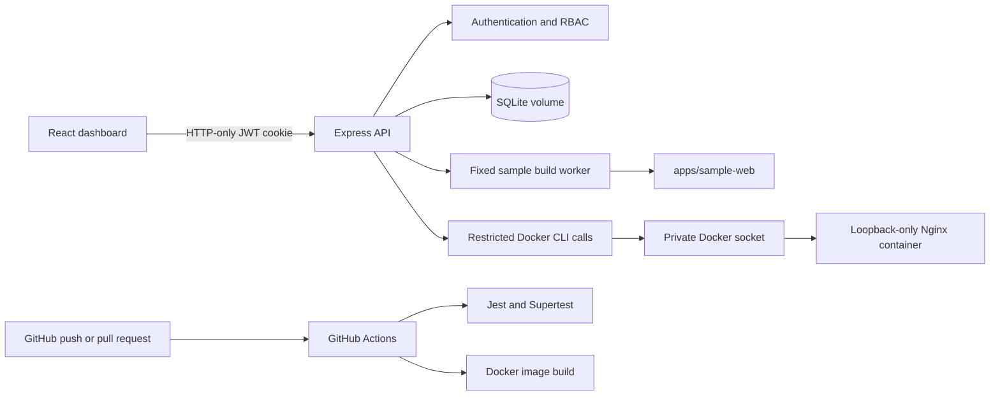

# Architecture and implementation plan

## Phased implementation

1. **Foundation:** separate React and Express workspaces, environment configuration, SQLite schema, sample application, and ignore rules.
2. **Identity and data:** password hashing, HTTP-only JWT session, validation, ownership checks, admin authorization, relational records, and audit events.
3. **Delivery services:** execute the fixed sample build, store build status/output, build a Docker image, start a constrained loopback container, and expose deployment results.
4. **Operations UI:** responsive login/registration, user dashboard, build history/logs, deployment history, and admin monitoring/user controls.
5. **Automation and proof:** Jest/Supertest tests, GitHub Actions checks, Docker Compose health/persistence, and beginner-oriented documentation.

## System diagram

## Runtime boundaries

- Public registration always creates a normal user. Admin creation is an explicit local CLI operation.
- Application records can only select the bundled `sample-web` template.
- Builds run a fixed Node.js build script with no shell and a fixed working directory.
- Deployments use fixed Docker argument arrays, generated container/image names, and `127.0.0.1` host binding. No client-provided command or port is interpolated into a process call.
- The Docker socket is a privileged host interface. Run this project only in a trusted, isolated environment.
- Dashboard APIs scope application/build/deployment access to the owner, except for administrators.

## Main request lifecycle

1. The browser sends the session cookie to the API.
2. Authentication middleware validates the JWT and loads the active user from SQLite.
3. Routes validate request schemas and verify object ownership/role.
4. A build/deployment request writes a `Pending` record, then starts the bounded worker.
5. Worker output is appended to build logs and status is changed based on actual process completion.
6. The dashboard refreshes status and history every five seconds.
